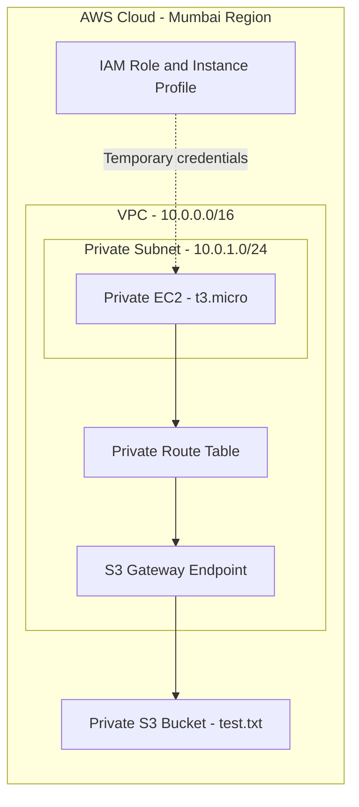

Secure Private EC2-to-S3 Connectivity Using Terraform

Project Overview
This project provisions AWS infrastructure using Terraform to enable a private EC2 instance to access Amazon S3 through an S3 Gateway VPC Endpoint without requiring a public IP address, NAT Gateway or Internet Gateway. IAM roles and instance profiles provide temporary credentials for read-only S3 access.
Architecture

**AWS Resources**
Resource	Configuration
Region	ap-south-1 (Mumbai)
VPC	10.0.0.0/16
Private subnet	10.0.1.0/24, ap-south-1a
EC2	t3.micro, no public IP
S3	ec2-s3-bucket-sathish-nh, public access blocked
IAM	EC2 role, instance profile, AmazonS3ReadOnlyAccess
Security group	SSH from VPC CIDR; outbound traffic allowed
VPC endpoint	Gateway, com.amazonaws.ap-south-1.s3
Route table	Local route and automatically managed S3 prefix-list route

Key Features
- Infrastructure as Code using Terraform and AWS provider 6.x.
- Private S3 connectivity through the AWS network.
- IAM-based authentication without manually storing AWS access keys on EC2.
- S3 public access blocking.
- No NAT Gateway or Internet Gateway required for S3 access.
- Implicit Terraform dependencies through resource references.
Prerequisites
- AWS account and configured AWS CLI credentials with provisioning permissions.
- Terraform installed.
- Existing EC2 key pair named awsday2 in Mumbai.
- Valid AMI ID for Mumbai and a globally unique S3 bucket name. Update main.tf if necessary.
- AWS CLI preinstalled on the EC2 AMI for connectivity testing.
Deployment
Clone your fork or repository and enter its directory. Ensure main.tf and test.txt are present.
terraform init
terraform fmt
terraform validate
terraform plan
terraform apply
Review the plan before approving the deployment.
Terraform Implicit Dependencies
Terraform determines resource creation order using references such as:
vpc_id = aws_vpc.ec2_s3_vpc.id
bucket = aws_s3_bucket.ec2-s3-bucket-sathish-nh.id
The subnet, security group and route table depend on the VPC. The S3 object depends on the bucket. The EC2 instance depends on its subnet, security group and IAM instance profile. The gateway endpoint depends on the VPC and route table.
Connectivity Testing
The isolated EC2 instance cannot be reached directly from the internet. Use a separately configured bastion host, Systems Manager with the required permissions and interface endpoints, or a boot-time test through EC2 user data. These access mechanisms are not included in the base configuration.

From the private EC2 instance, using its IAM role and an installed AWS CLI:
aws s3 ls s3://ec2-s3-bucket-sathish-nh --region ap-south-1
aws s3 cp s3://ec2-s3-bucket-sathish-nh/test.txt /tmp/test.txt --region ap-south-1
cat /tmp/test.txt
Expected output:
EC2 to S3 private connectivity successful
Verify that the endpoint is Available, the private subnet is associated with the correct route table, and the route table contains the S3 prefix-list route targeting the endpoint. Confirm that the EC2 instance has no public IP and no default internet route.
Security and Cost Optimization
S3 Gateway Endpoints have no additional endpoint charges. Standard EC2, EBS and S3 charges still apply. The IAM policy in this learning project grants broad S3 read-only permissions; a production deployment should restrict access to the required bucket and objects. Public access blocking does not enforce endpoint-only access; a carefully designed bucket policy using aws:SourceVpce can provide that additional restriction.
Real-World Applications
- Secure retrieval of application configuration files and deployment artifacts.
- Private access to datasets and documents stored in S3.
- Cloud infrastructure with reduced reliance on NAT Gateways.
Deployment Evidence
Add actual AWS Console screenshots and CLI test results after completing deployment and verification.
Cleanup
terraform destroy
Review the destruction plan before approving. Remove any additional objects from the bucket if they prevent deletion.
Future Enhancements
- Bucket-specific least-privilege IAM policy.
- Endpoint policy and endpoint-restricted bucket access.
- Systems Manager private management access.
- Reusable Terraform modules and remote state.
Author
Sathishkumar — Cloud and DevOps enthusiast
